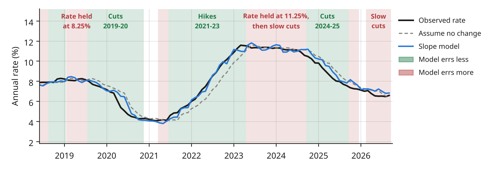

# Mexico's yield curve: pattern, forecasts and the value of the pattern

[](https://colab.research.google.com/github/alexmufe/rendimiento_bonos/blob/main/mexico_yield_curve.ipynb)

Author: Alejandro Muñoz Fernández. The full analysis is in the brief, [rendimiento_bonos_brief.pdf](rendimiento_bonos_brief.pdf).

This project studies twenty years (October 2006 to September 2026) of monthly primary-auction rates for nine Mexican government instruments: CETES at 28, 91, 182 and 364 days and BONOS M at 3, 5, 10, 20 and 30 years. It asks three questions.

## Summary

**1. Is there a pattern in how the nine maturities move?** Yes. The curve moves in three typical ways: the level (all rates rise or fall together), the slope (the gap between short and long rates widens or narrows) and the curvature (the 3- and 5-year bonds move differently from the ends). Together they explain 99% of annual changes, and the level alone 86%. The slope follows Banxico's policy rate, and since 2012 the level has also moved with the 10-year US Treasury.

**2. Can the curve be forecast one and four quarters ahead?** For CETES, yes. Each model was estimated month by month from December 2012 with only the information available at that date, and compared with assuming the rate does not change.

| | CETES | BONOS M |
|---|---|---|
| **3 months ahead** | The CETES slope (364-day minus 28-day rate) cuts the error by 12% to 35% | Nothing beats assuming no change |
| **12 months ahead** | Banxico's survey of analysts cuts the error by about 22%, in 2013-2019 and in 2020-2026 | Nothing beats assuming no change |

**3. Does the pattern improve the forecasts?** It depends on how it is used. As a signal of what the market expects Banxico to do, it helps: the CETES slope alone matches a model with all nine rates. Assuming that each movement reverts to its historical average hurts, because that average shifted with each Banxico cycle (Diebold and Li's model errs 9% more at 3 months than forecasting each rate from its own history).

The figure shows why the slope works: it anticipates the rate while Banxico is moving it, and it errs more while Banxico holds it.

<picture>
  <source media="(prefers-color-scheme: dark)" srcset="images/cete91_forecast_dark.png">
  
</picture>

*91-day CETE, forecast three months ahead. Green: the slope model errs less than assuming no change (three-month average); red: it errs more.*

## How to run it

**In Google Colab (nothing to install):** open the notebook with the badge above and choose *Runtime > Run all*. The first cell downloads this repository, and the notebook runs from start to finish in about a minute. It ends with a traceability table that compares each number in the brief with the value computed here.

**Locally:**

```bash
git clone https://github.com/alexmufe/rendimiento_bonos.git
cd rendimiento_bonos
pip install -r requirements.txt
jupyter notebook mexico_yield_curve.ipynb
```

## Contents

- `mexico_yield_curve.ipynb`: the notebook, organized in five steps (check the data, find the pattern, test forecasts, measure the value of the pattern, test additional information).
- `rendimiento_bonos_brief.pdf`: the brief with the results.
- `data/`: monthly averages of primary auctions (Banco de México).
- `*.py`: the modules the notebook calls (data checks, external and survey data with their sources, models and tests, figures). Tables and figures are written to `outputs/` when the notebook runs.

Data sources: Banco de México (auctions, policy rate, survey of analysts, foreign holdings), FRED (US Treasury yields, peso per dollar), Federal Reserve Bank of Philadelphia (Survey of Professional Forecasters) and Banco Central de Reserva del Perú (EMBIG Mexico spread).

Code under the MIT License. The data belong to their sources.
